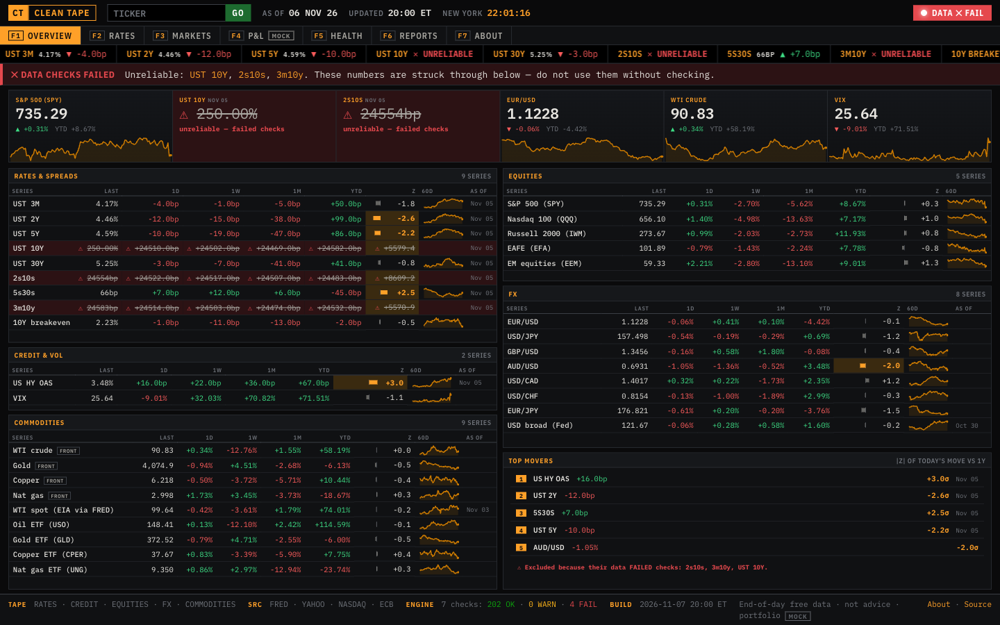
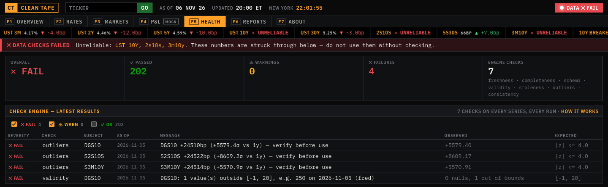
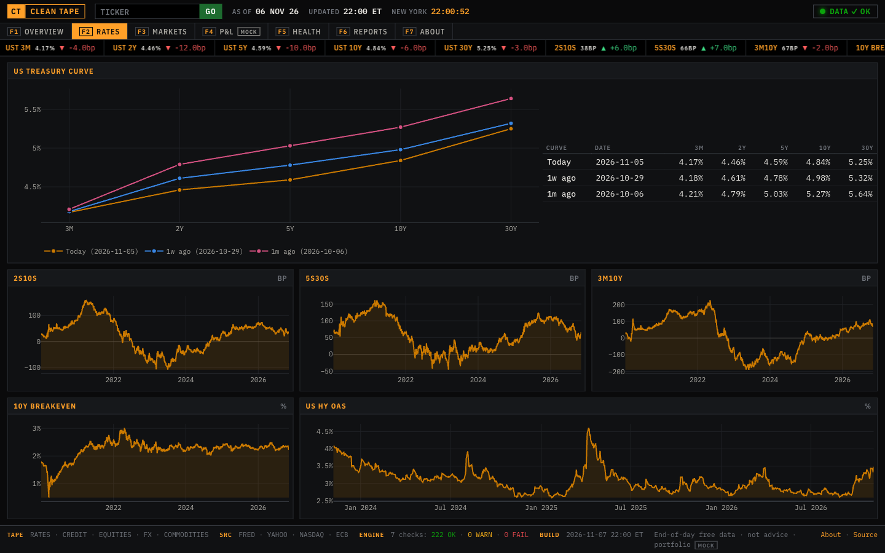
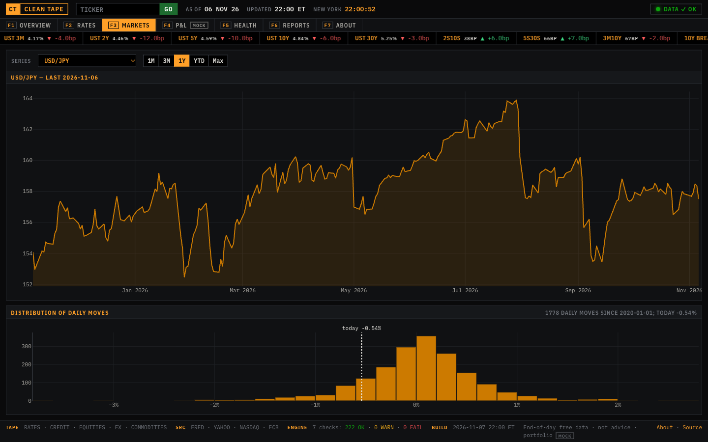
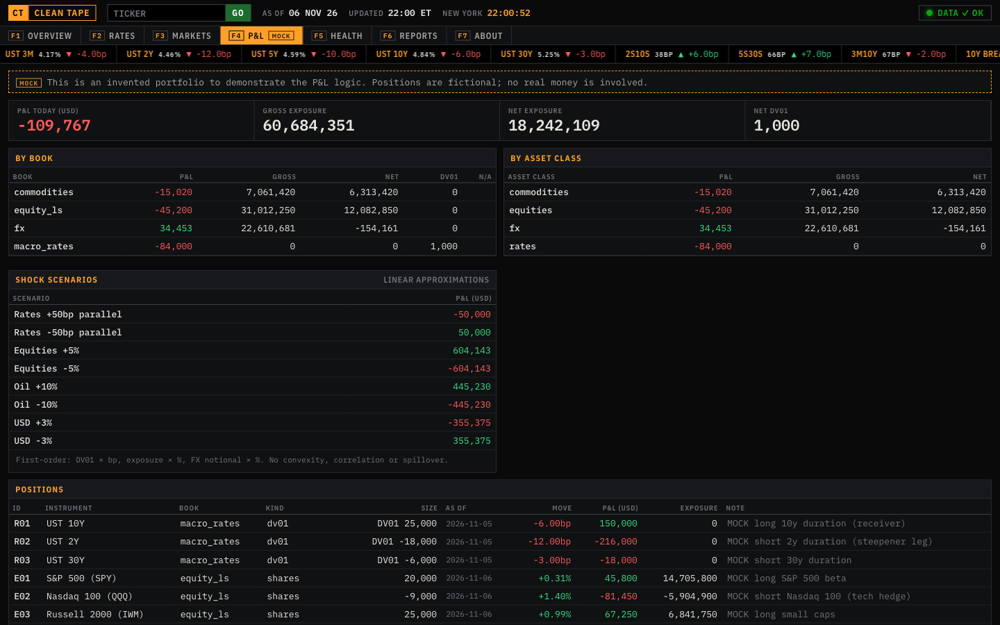
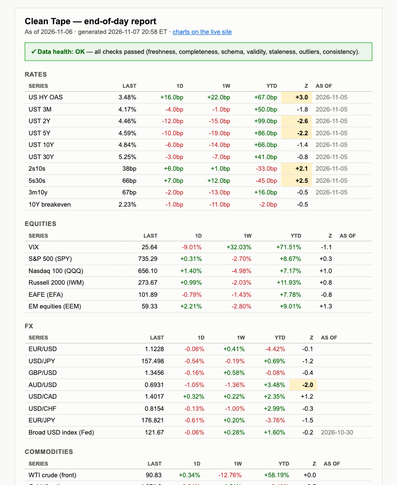
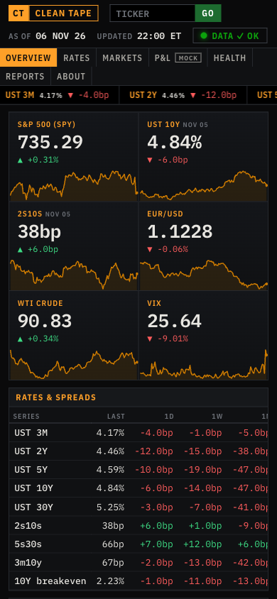
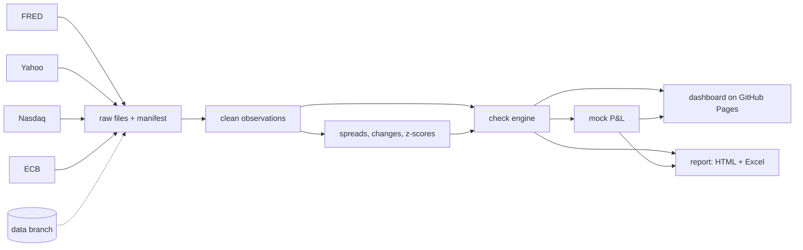

# Clean Tape

A morning markets dashboard and end-of-day report for US rates, credit, equities, FX and commodities. Every number passes a 7-check data-quality engine before anyone sees it.

[](https://github.com/DanielDistor/clean-tape/actions/workflows/daily.yml)
[](https://github.com/DanielDistor/clean-tape/actions/workflows/ci.yml)

**Live: [danieldistor.github.io/clean-tape](https://danieldistor.github.io/clean-tape/)** · **Failure demo: [/demo](https://danieldistor.github.io/clean-tape/demo/)**


## Why I built it

Every morning someone on an investment team opens a dozen sites, copies closing prices into a spreadsheet, works out the moves and then has to decide whether the numbers can be trusted. Yields publish a day late. Holidays differ by market. A vendor changes a column name and a cell quietly goes stale. Clean Tape automates that whole routine and puts the checking first. It pulls the data twice a day, runs it through a set of checks and only then builds the dashboard and the report. When a number fails, the page says so in red and the number is struck through. It never shows a bad print as if it were fine.

"The tape" is trader slang for the market data feed. This project cleans it.

It runs entirely on free GitHub infrastructure. Actions does the compute on a schedule, Pages hosts the site and an orphan git branch holds the data. There are no servers and no API keys.

## What's on the tape

| Asset class | Series | Source | Cross-checked against |
|---|---|---|---|
| US rates | UST 3M, 2Y, 5Y, 10Y, 30Y, 10Y breakeven, 2s10s, 5s30s, 3m10y | FRED | each spread must equal its legs |
| Credit | US high-yield OAS | FRED | |
| Volatility | VIX | Yahoo Finance | |
| Equities | SPY, QQQ, IWM, EFA, EEM | Yahoo Finance with Nasdaq as fallback | |
| FX | EUR/USD, USD/JPY, GBP/USD, AUD/USD, USD/CAD, USD/CHF, EUR/JPY, Fed broad dollar | Yahoo Finance, FRED | ECB reference rates for every pair, EUR/JPY against EUR/USD × USD/JPY |
| Commodities | WTI, gold, copper and nat gas front-month futures, USO, GLD, CPER, UNG, WTI spot | Yahoo Finance, FRED | WTI futures against EIA spot |

Behind those series sits the reference data the engine needs: four trading calendars (NYSE, the US bond market, ECB TARGET and FX), the publication lag of each source and realistic bounds for every instrument. All of it lives in `config/`, so adding an instrument means adding a few lines of YAML. A mock 13-position portfolio across rates, equities, FX and commodities is valued on top.

## The check engine

Seven checks run on every series on every pull. Each one rates a series OK, WARN or FAIL and the run takes the worst result. The code is in [`src/cleantape/checks/`](src/cleantape/checks).

| Check | What it asks | Rule |
|---|---|---|
| Freshness | Is the latest value as recent as the calendar and the source's publishing delay say it should be? | 1 business day behind is WARN, 2 or more is FAIL |
| Completeness | Are trading days missing? Did a download fail? Did a file arrive much smaller than usual? | 3 or more missing sessions is FAIL, rows ±50% of the median is WARN |
| Schema | Does each raw vendor file still have the columns and types the parser expects? | any problem is FAIL |
| Validity | Is the number plausible? Any nulls on trading days or duplicate records? | outside bounds or duplicate is FAIL |
| Staleness | Has a value stopped changing? | the same value for 4 sessions is WARN |
| Outliers | Is today's move abnormal against this series' own last year of daily moves? | \|z\| above 4 is WARN, above 6 is FAIL |
| Consistency | Do independent sources agree and do derived numbers add up? | tolerances calibrated from history |

The consistency tolerances come from data. I measured the gap between each pair of sources every day since 2021 and set WARN at the 99th percentile and FAIL at the 99.9th, each times 1.5. Yahoo and the ECB differ by about 0.2% on a normal day because the ECB fixes at 14:15 Frankfurt time and Yahoo closes hours later, so the FX tolerance lands near 1.5%. The EUR/JPY triangle is a single source and gets 0.1%. The full table is in [DECISIONS.md](docs/DECISIONS.md).

A FAIL does four things. It strikes the number through on the site, it takes the position out of the P&L, it puts a red box at the top of the end-of-day report and it turns the GitHub Actions run red so I get an email. An empty input or a check that crashes counts as a FAIL too.

Here is the dashboard after I fed it a 10-year yield of 250%. You can click through this yourself at [/demo](https://danieldistor.github.io/clean-tape/demo/), which is rebuilt from the real data on every run with that one number broken.





The 10Y is struck through, so are the spreads built from it, the ticker shows UNRELIABLE and the broken series are kept out of the top movers. `scripts/demo_checks.py` runs eleven broken versions of real data like this through the engine and shows each one caught.

## A look around

| | |
|---|---|
|  |  |
| **Rates.** The Treasury curve today against a week and a month ago, plus spread history. | **Markets.** Any series with range buttons and the distribution of its daily moves, with today marked. |
|  |  |
| **P&L (mock).** Position P&L by DV01 for rates, share count for ETFs and notional for FX converted to USD, plus linear shock scenarios. | **End-of-day report.** Email-safe HTML and a formatted Excel workbook, archived on the site every evening. |

The overview resizes itself to fit any desktop screen with no scrolling. On a phone it switches to a scrolling layout.



## How it works



A GitHub Actions workflow runs twice each weekday, once in the New York morning and once in the evening. GitHub's scheduler only speaks UTC and can fire late, so each run has two cron entries and a time window. The pipeline decides for itself whether it is inside the window and whether that slot already ran today. That keeps the schedule correct across daylight saving changes.

Each run pulls the previous state from the `data` branch and fetches every source with retries. Every response is saved untouched with a manifest entry recording its hash, row count and timing. The responses are then normalised into one table of observations keyed by date, instrument and source. Missing values stay missing, and a daily bar is only stored once its market has closed. After that the engine runs, the mock portfolio is valued, the evening run writes the report and the site is rebuilt. The new state goes back to the `data` branch as a single commit, so the history never grows.

Dates get special care because that is where pipelines usually break. Market dates are plain dates, timestamps are UTC and everything on screen is New York time. Each instrument follows its own calendar and publication lag. Treasury yields arrive a day after equities, so every row shows its own as-of date when it differs from the headline. More detail is in [ARCHITECTURE.md](docs/ARCHITECTURE.md).

## Things that broke while I built it

The [build log](docs/BUILD_LOG.md) has every one of these. A few of my favourites:

The WTI spot price from FRED kept showing up as missing on days the stock market was open. It turned out to follow the federal holiday calendar, so Columbus Day and Veterans Day have no price. I had put it on the NYSE calendar and the data proved me wrong.

My first calibration of the oil cross-check came out with a 55% tolerance, which would never fire. The cause was March 2020, when Cushing spot oil traded 40% below the front-month future during the storage crisis. That was real market behaviour, so I kept the data and started the calibration window in 2021.

A test caught a subtle bug in the duplicate-download logic. If a run fetched the day's closing prices at 16:20 it held them back because the market data wasn't final until 16:30. The next run downloaded identical bytes, saw the same hash and skipped the file. That close would never have been stored. The manifest now records held-back rows and re-processes the file.

The "biggest moves" strip once ranked a broken 250% yield as the top mover of the day. A ranking by z-score is designed to surface the most extreme number, and a bad print is the most extreme number there is. Failed series are now excluded from it, and from the P&L history too.

My `.gitignore` had `site/` in it to skip the build output. It also matched the dashboard's source package, so seven phases of commits never contained it. Everything worked on my laptop. The first GitHub run failed with a missing module and now I test from a fresh clone before pushing.

## Run it yourself

You need Python 3.12 and [uv](https://docs.astral.sh/uv/).

```bash
git clone https://github.com/DanielDistor/clean-tape && cd clean-tape
make setup       # install pinned dependencies
make bootstrap   # download history from 2020 into ./state (about 15 seconds)
make run         # full pipeline: ingest, checks, P&L, report, site
make serve       # http://localhost:8000 (use make serve PORT=8001 if 8000 is busy)
```

`make test` runs 166 tests with no network access. `uv run cleantape status` prints the last runs and current health, and `uv run cleantape check --audit` runs the validity and outlier checks across all of history.

The data is queryable with SQL through DuckDB:

```bash
uv run cleantape query "SELECT date, round(value, 1) AS s2s10s_bp FROM derived
                        WHERE series_id = 'S2S10S' ORDER BY date DESC LIMIT 5"
```

`uv run cleantape query --examples` lists more, such as the biggest moves since 2020 or Yahoo against ECB EUR/USD on the same dates.

## Deploy your own copy

Fork the repo and keep it public, since free GitHub Pages needs that. In the repo settings set Pages to deploy from GitHub Actions and give workflows read and write permission. Then build the history on your laptop and push it to the `data` branch:

```bash
make setup && make bootstrap && make run
scripts/push_state.sh
```

Yahoo sometimes blocks GitHub's servers for large downloads, which is why the first backfill runs locally. After that, run the `daily` workflow once from the Actions tab and the site goes live. It updates every weekday morning and evening from then on. Remember to point `site.base_url` in `config/settings.yaml` at your own URL.

## The manual routine it replaces

By hand this means opening FRED for nine series, Yahoo or a terminal for twenty more and the ECB for a sanity check on FX. Then you paste everything into a workbook while making sure each number belongs to the right date, work out the daily, weekly, monthly and year-to-date moves, rebuild the spreads, recompute the book's P&L and shocks, scan for anything odd, format it and send it. I'd estimate 45 to 60 minutes a day. The error checking is the step most likely to get skipped when time is short, and here it runs every time.

## Limits

This uses free end-of-day data. Yahoo is unofficial and can break or block cloud servers at any time, and the Nasdaq fallback only covers the ETFs. The bond market calendar is an approximation of SIFMA's built from federal holidays plus Good Friday, so early closes aren't modelled. Futures are continuous front-month contracts and jump on roll days, which is why they are display-only and the portfolio holds ETFs instead. The P&L and the shocks are linear. The FX cross-checks catch gross errors such as a wrong pair or a stale feed, while basis-point drift slips under their tolerance. FRED only serves about three years of high-yield spread history. GitHub can run a scheduled job late or skip it, and it pauses schedules on repos with no activity for 60 days. The portfolio is mock.

## Repo layout

```
config/            universe, settings, mock portfolio, calibrated tolerances
src/cleantape/
  ingest/          FRED, Yahoo, Nasdaq, ECB, landing zone and manifest
  transform/       normalise, derive spreads, changes and z-scores
  checks/          the 7-check engine
  portfolio/       P&L, exposures, shocks
  site/            dashboard templates, CSS, JS
  report/          HTML and Excel end-of-day report
tests/             166 tests on real captured data and broken copies of it
docs/              architecture, decisions, build log, runbook
```

[ARCHITECTURE.md](docs/ARCHITECTURE.md) covers the pipeline, the state layout and the scheduling. [DECISIONS.md](docs/DECISIONS.md) records every non-obvious choice with a line of reasoning. [BUILD_LOG.md](docs/BUILD_LOG.md) is the honest list of what went wrong. [RUNBOOK.md](docs/RUNBOOK.md) says what to do when a feed is late, Yahoo is blocked or a check fails.

Data comes from FRED, Yahoo Finance, Nasdaq and the ECB and is used here for a non-commercial demo. Nothing here is investment advice.
