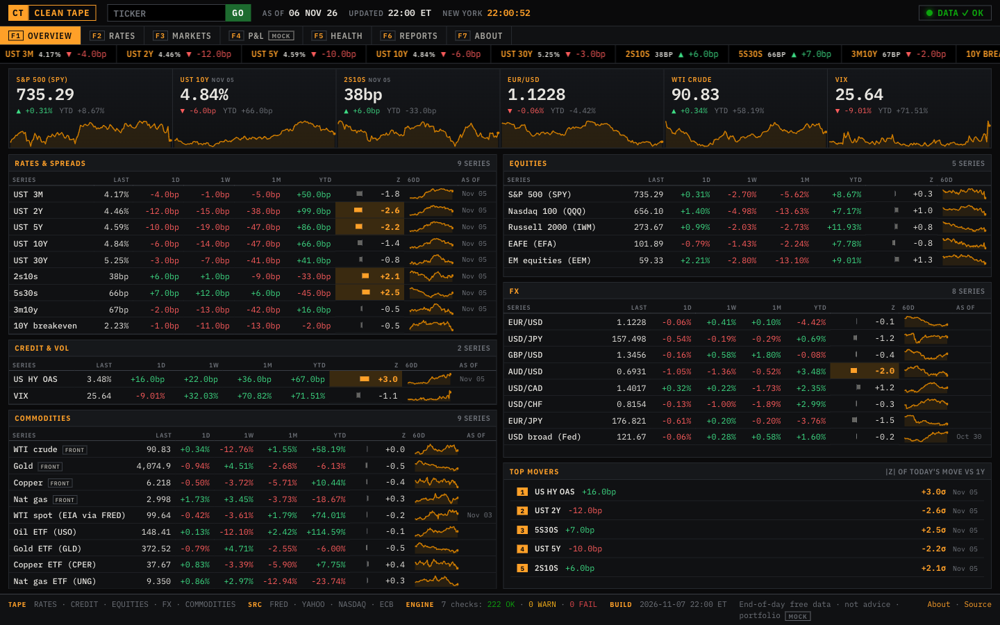
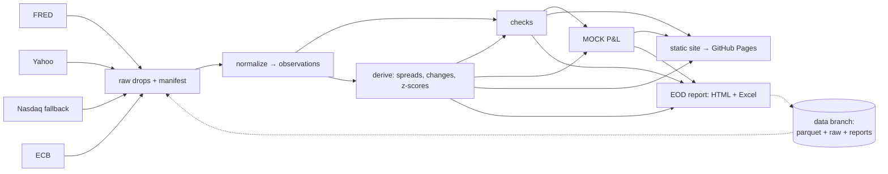

# Clean Tape

**A morning markets dashboard and end-of-day report covering US rates, credit, equities, FX and commodities, where every number passes a 7-check data-quality engine before anyone sees it.**

[](https://github.com/DanielDistor/clean-tape/actions/workflows/daily.yml)
[](https://github.com/DanielDistor/clean-tape/actions/workflows/ci.yml)

**Live site → https://danieldistor.github.io/clean-tape/**

Clean Tape pulls end-of-day rates, credit, equity, FX and commodity data from four free sources twice every weekday. It stores every vendor response untouched, turns them into one clean, queryable dataset, and runs seven kinds of data-quality checks: freshness, completeness, schema, validity, stale values, outliers and cross-source consistency. Only then does it publish a one-screen dashboard and an end-of-day report (HTML + Excel). When a number fails a check, it is struck through, flagged in red and kept out of the P&L. It is never shown as if it were fine. It all runs on free GitHub infrastructure: Actions for compute, Pages for the site, a git branch for state. No servers, no API keys.



> *Screenshot: the Overview page at 1440×900. To refresh it, open the live site in a desktop browser at that size after an evening run, wait for it to load, and capture the viewport. Save it as `docs/img/overview.png`.*

## What it does

It mirrors four internal tools an investment-technology team builds:

| Use case | In Clean Tape |
|---|---|
| **A morning dashboard** that puts the numbers the investment team checks every day on one screen | [Overview](https://danieldistor.github.io/clean-tape/): rates & spreads, credit & vol, equities, FX, commodities with last / 1d / 1w / 1m / YTD / z-score, sparklines, biggest moves; plus Rates, Markets, Portfolio and Health pages |
| **A pipeline that turns a vendor's daily file drop into a clean, queryable dataset** | `cleantape ingest`: raw drops land untouched with a manifest (hash, rows, timing). They're normalised into `observations.parquet` (idempotent upserts, revision tracking), queryable with `cleantape query "SQL"` (DuckDB) |
| **An automated end-of-day report that replaces an analyst's manual Excel workflow** | `cleantape report`: email-safe HTML and a formatted Excel workbook (7 sheets, real number formats, conditional formatting, print setup), archived on the [Reports](https://danieldistor.github.io/clean-tape/reports.html) page |
| **A check that flags when a data feed arrives late, incomplete, or with numbers that don't add up** | `cleantape check`: 7 checks with calibrated thresholds. A FAIL turns the site red, puts a warning box at the top of the report, and fails the GitHub Actions run |

## Architecture



Each run (morning and evening, New York time) pulls the state from an orphan `data` branch and fetches every source. Responses are saved untouched, normalised, then derived values and checks are computed. The MOCK portfolio is valued, the report is written (evening only), and the site is built. The state is pushed back as a single commit, so history never grows, and the site is deployed to Pages. Dates, calendars, publication lags and DST-proof scheduling are covered in **[docs/ARCHITECTURE.md](docs/ARCHITECTURE.md)**.

## What's on the tape

| Asset class | Series on the dashboard | Source | Independent cross-check |
|---|---|---|---|
| US rates | UST 3M, 2Y, 5Y, 10Y, 30Y · 10Y breakeven · 2s10s, 5s30s, 3m10y spreads | FRED | spreads must equal their legs |
| Credit | US high-yield OAS | FRED | — |
| Volatility | VIX | Yahoo Finance | — |
| Equities | S&P 500 (SPY), Nasdaq 100 (QQQ), Russell 2000 (IWM), EAFE (EFA), EM (EEM) | Yahoo Finance, Nasdaq fallback | — |
| FX | EUR/USD, USD/JPY, GBP/USD, AUD/USD, USD/CAD, USD/CHF, EUR/JPY, Fed broad dollar index | Yahoo Finance, FRED | ECB reference rates for all 7 pairs; EUR/JPY vs EUR/USD × USD/JPY |
| Commodities | WTI, gold, copper, nat gas front-month futures · USO, GLD, CPER, UNG ETFs · WTI spot | Yahoo Finance, FRED | WTI futures vs EIA spot |

Plus the reference data the engine relies on: four trading calendars (NYSE, US bond market, ECB TARGET, FX), per-source publication lags, and validity bounds for every instrument, all in `config/`. A MOCK 13-position portfolio across rates, equities, FX and commodities is valued on top.

## Data sources

| Source | Provides | Publication lag (measured) | Known quirks |
|---|---|---|---|
| [FRED](https://fred.stlouisfed.org) keyless CSV | UST 3M/2Y/5Y/10Y/30Y, 10Y breakeven, HY OAS, broad dollar index, WTI spot | Treasuries & HY OAS: 1 business day; broad dollar: weekly (≈5); WTI spot: weekly (≤5) | Missing values are now empty (used to be `.`); date column renamed `DATE`→`observation_date`; multi-series requests ignore the start date; HY OAS history limited to ~3 years; WTI spot follows the federal calendar |
| [Yahoo Finance](https://finance.yahoo.com) via `yfinance` | SPY, QQQ, IWM, EFA, EEM, VIX, 7 FX pairs, CL/GC/HG/NG front-month, USO/GLD/CPER/UNG | same evening | Unofficial; may rate-limit or block cloud IPs. Returns in-progress daily bars and weekend FX bars (both filtered). Column shape differs by version (handled). Equity closes dividend-adjusted (`auto_adjust=True`) |
| [Nasdaq](https://www.nasdaq.com) quote history | Fallback for the US ETFs when Yahoo fails | same evening | Unadjusted closes; returns nothing unless the window ends recently. Replaces Stooq, which now serves a JavaScript challenge |
| [ECB Data Portal](https://data.ecb.europa.eu) | EUR reference rates for USD, JPY, GBP, CHF, CAD, AUD | same day, ~16:00 CET | Quoted as foreign currency per 1 EUR; converted to Yahoo conventions (USDJPY = JPY/EUR ÷ USD/EUR, …) |

## The check engine

Seven checks run on every series on every pull, before anything reaches the site or the report (`src/cleantape/checks/`). Each rates every series OK / WARN / FAIL; the run takes the worst. A FAIL strikes the number through, keeps it out of P&L and rankings, puts a red box on the report and fails the GitHub run. Empty input or a crashed check is itself a FAIL.

| Check | Catches | Thresholds | How they were set |
|---|---|---|---|
| Freshness | Latest date behind what calendar + publication lag + run time imply | 1 business day = WARN, ≥2 = FAIL | Lags measured from the data per source |
| Completeness | Gaps in the last 10 sessions; failed drops; raw row counts vs history | 1–2 missing = WARN, ≥3 = FAIL; rows ±50% of trailing median = WARN | Row counts compared only between drops with the same date window |
| Schema | Missing/renamed columns, non-numeric values, unparseable dates in each raw drop | any problem = FAIL | Rules per source, tested on hand-broken real files |
| Validity | Out-of-bounds values, nulls on trading days, duplicate keys | out of bounds / duplicates = FAIL; null = WARN | Bounds cover real history (WTI −$37, VIX 82, ~0% bills) but reject yield = 250, price = 0. `check --audit` confirms over 2020→today |
| Stale values | Same value for ≥4 sessions (dead feed) | WARN | WARN only: ZIRP-era bills really did sit at 0.05% for 10 sessions |
| Outliers | Today's move vs its own last 252 daily moves | \|z\| > 4 WARN, > 6 FAIL | Futures capped at WARN, with a "possible roll" hint when the matching ETF was calm |
| Consistency | Yahoo FX vs ECB; CL=F vs WTI spot; EURJPY vs EURUSD×USDJPY; spreads = legs | FX ≈1.1–2.3% WARN; triangle 0.10% WARN / 0.90% FAIL; WTI 8.7% / 10.6% | `cleantape calibrate`: 99th / 99.9th percentile of \|a/b − 1\| since 2021 × 1.5 (table in [DECISIONS.md](docs/DECISIONS.md)) |

Empty input is always a FAIL, and so is a check that crashes. `scripts/demo_checks.py` runs 11 deliberately broken versions of real data (late feeds, a 250% yield, a dead feed, a 38bp spike, ECB 5% off, duplicate keys, …) through the real runner and shows each one caught.

## Quickstart (≈5 minutes)

Requires Python 3.12 and [uv](https://docs.astral.sh/uv/).

```bash
git clone https://github.com/DanielDistor/clean-tape && cd clean-tape
make setup       # uv sync: pinned dependencies
make bootstrap   # backfill 2020-01-01 → today into ./state (~15 s)
make run         # full pipeline: ingest, checks, P&L, EOD report, site
make serve       # http://localhost:8000
```

Other useful commands: `make test` (no network), `make lint`, `uv run cleantape status`, `uv run cleantape check --audit`, `uv run cleantape pnl`, `uv run cleantape --help`.

### Example queries

`uv run cleantape query "<SQL>"` runs DuckDB over the parquet files. Views: `observations`, `derived`, `latest`, `catalog`, `manifest`, `check_results`, `runs`. `uv run cleantape query --examples` prints these:

```sql
-- 1. Latest value and move for every displayed series
SELECT series_id, name, date, round(value, 4) AS value, round(chg_1d, 2) AS chg_1d, round(z_1d, 2) AS z
FROM latest WHERE display_group IS NOT NULL ORDER BY display_group, display_order;

-- 2. 2s10s over the last 10 sessions (bp)
SELECT date, round(value, 1) AS s2s10s_bp FROM derived WHERE series_id = 'S2S10S' ORDER BY date DESC LIMIT 10;

-- 3. Biggest absolute z-score moves since 2020
SELECT date, series_id, round(chg_1d, 2) AS chg_1d, round(z_1d, 1) AS z FROM derived
WHERE z_1d IS NOT NULL ORDER BY abs(z_1d) DESC LIMIT 10;

-- 4. Yahoo vs ECB EUR/USD on the same dates
SELECT y.date, y.value AS yahoo, e.value AS ecb, round((y.value / e.value - 1) * 1e4, 1) AS diff_bp
FROM observations y JOIN observations e ON y.date = e.date AND e.instrument_id = 'EURUSD_ECB'
WHERE y.instrument_id = 'EURUSD' ORDER BY y.date DESC LIMIT 10;

-- 5. Ingest history: drops per source and status
SELECT source, status, count(*) AS drops, max(received_at_utc) AS last_received
FROM manifest GROUP BY ALL ORDER BY source, status;
```

## Deployment (your own copy)

1. **Fork** this repo. It must be public for free GitHub Pages.
2. **Settings → Pages → Build and deployment → Source: "GitHub Actions".**
3. **Settings → Actions → General → Workflow permissions: "Read and write permissions"** (lets the workflow push the `data` branch).
4. Create the `data` branch from your laptop. This is more reliable than Actions because Yahoo often blocks cloud IPs for big downloads:
   ```bash
   make setup && make bootstrap && make run
   scripts/push_state.sh
   ```
5. **Actions → daily → Run workflow** (slot `evening`, force ✓). The site appears at `https://<you>.github.io/clean-tape/`. From then on it updates every weekday morning and evening.
6. Edit `site.base_url` / `site.repo_url` in `config/settings.yaml` to point at your copy.

## The manual workflow this replaces

What an analyst would do by hand each evening to produce the same report in Excel:

1. Open FRED for five Treasury yields, the breakeven, HY OAS, the dollar index and WTI spot. Download or copy the latest values.
2. Open Yahoo Finance (or a terminal) for 5 equity ETFs, VIX, 7 FX pairs, 4 futures and 4 commodity ETFs. Copy the closes.
3. Open the ECB reference rates page to sanity-check FX.
4. Paste everything into the master workbook. Make sure each number is for the right date, especially yields that publish a day late and holidays that differ by market.
5. Compute 1d/1w/1m/YTD changes (bp for yields, % for prices), the 2s10s/5s30s/3m10y spreads, and eyeball for anything unusual.
6. Recompute the book's P&L by position (DV01 for rates, FX converted to USD) and the shock table.
7. Check for errors: stale cells, a yield that's actually a price, a missing holiday row, a copy-paste off by one row.
8. Format the sheets, write a short summary, and email it.

**Estimate (not measured):** roughly 45–60 minutes per day, or about 4–5 hours a week, with the error-checking in step 7 being the part most likely to be skipped under time pressure. Clean Tape does it in under a minute of compute, and step 7 runs every time.

## Limitations: where this falls short

- **End-of-day free data only.** No intraday, no official vendor feed, no SLA. Yahoo is unofficial and can break or block cloud IPs at any time. Nasdaq is only a partial fallback (ETFs, unadjusted closes). VIX, FX and futures have none.
- **The bond-market calendar is approximated** (federal holidays + Good Friday). SIFMA early closes and one-off closures aren't modelled.
- **Futures are continuous front-month, not roll-adjusted.** That's why they are display-only and the portfolio holds ETFs.
- **FX cross-source checks are loose** (~1.5%) because the ECB fixes at 14:15 CET and Yahoo closes later. They catch gross errors, not basis-point drift.
- **P&L and shocks are linear and simplified**: no convexity, carry, financing or correlation. **The portfolio is MOCK.**
- **GitHub cron isn't punctual**: runs can be late or dropped. Scheduled workflows stop after 60 days of repo inactivity (see [RUNBOOK](docs/RUNBOOK.md)).
- **HY OAS history starts in late 2023** (FRED/ICE licensing).

## What I'd do differently / next

- TODO(me): …
- TODO(me): …
- TODO(me): …

## Docs

- [docs/ARCHITECTURE.md](docs/ARCHITECTURE.md): pipeline, state layout, dates/calendars/timing, scheduling
- [docs/DECISIONS.md](docs/DECISIONS.md): every non-obvious choice, with one line of reasoning
- [docs/BUILD_LOG.md](docs/BUILD_LOG.md): what went wrong while building it and what I learned
- [docs/RUNBOOK.md](docs/RUNBOOK.md): late feeds, Yahoo blocked, FAILs, reruns, re-bootstrap, adding an instrument

*Not investment advice. Data © the respective providers; used for a non-commercial demonstration.*
