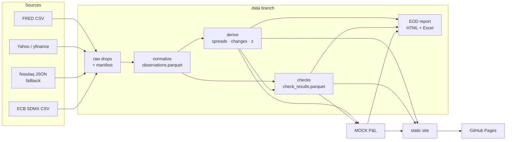

# Architecture

Clean Tape is one batch pipeline that runs twice per weekday on GitHub Actions, keeps its state as
parquet files on an orphan `data` branch, and publishes a static site to GitHub Pages.



## Stages

| Stage | Module | In → out |
|---|---|---|
| Ingest | `ingest/{fred,yahoo,nasdaq,ecb}.py`, `ingest/landing.py` | HTTP → `raw/{source}/{as_of}/…` + `meta/manifest.parquet` |
| Normalize | `transform/normalize.py` | raw drops → `curated/observations.parquet` (PK `date, instrument_id, source`, upsert) |
| Derive | `transform/derive.py` | observations → `curated/derived.parquet` (best source, spreads, crosses, changes, z) |
| Checks | `checks/*.py`, `checks/runner.py` | state → `meta/check_results.parquet`, overall OK/WARN/FAIL |
| P&L | `portfolio/pnl.py` | derived + `config/portfolio.csv` + FAIL flags → positions, books, shocks |
| Report | `report/build.py`, `report/excel.py` | → `reports/{date}/eod_{date}.{html,xlsx}` |
| Site | `site/build.py` | → `site/` (never committed; deployed as a Pages artifact) |
| Orchestration | `pipeline.py`, `cli.py` | slot guard, stage timing, `meta/runs.parquet` |
| State sync | `store/sync.py` | `./state` ⇄ `origin/data` (one force-pushed commit) |

Design rules:

- **A failing source never stops the run.** Each fetch returns a `RawDrop` with `ok=False` instead of raising; the manifest records it and the checks decide what it means.
- **A failing stage never stops the run either.** `pipeline.StageRecorder` catches, logs and records the failure; later stages run where they can, and the site is always rebuilt so it can show the failure.
- **Checks never pass on nothing.** Zero rows or a crashed check is a FAIL row.
- **Bad numbers are never displayed as fine.** FAIL-flagged series are struck through, excluded from rankings, and turn P&L into "n/a — data issue". Derived series inherit their legs' flags.
- **Parquet is the source of truth.** DuckDB is used in-memory for `cleantape query`; there is no database file to keep in sync.

## Dates, calendars and timing

This is where naive pipelines break, so it is handled explicitly and tested.

### Dates vs timestamps

- An observation's `date` is a plain `datetime.date`: **the market date the value belongs to**.
- Every timestamp the pipeline stores (`received_at_utc`, `ingested_at_utc`, run start/finish) is **timezone-aware UTC**. Ruff's `DTZ` rules reject naive datetimes in library code.
- Everything people see is shown in **America/New_York** (`clock.fmt_ny`).
- Nothing calls `datetime.now()` except `clock.SystemClock`. Code receives a `Clock`; tests use `FixedClock`; `CLEANTAPE_NOW` pins the clock for reruns.

### Calendars (`calendars.py`)

| Name | Definition | Used by |
|---|---|---|
| `nyse` | `exchange_calendars` XNYS sessions | equities, ETFs, VIX, futures (approximation of CME) |
| `us_bond` | weekdays − US federal holidays − Good Friday | Treasuries, breakeven, HY OAS, Fed dollar index, WTI spot |
| `ecb_target` | weekdays − 1 Jan, Good Friday, Easter Monday, 1 May, 25–26 Dec | ECB reference rates |
| `fx_weekday` | Monday–Friday | Yahoo FX |

`us_bond` approximates the SIFMA calendar. The case that matters: **Columbus Day and Veterans Day are bond-market holidays while NYSE trades**, so a missing Treasury yield on those days is not late (tested). Not modelled: SIFMA early closes, one-off closures (e.g. the 2025-01-09 national day of mourning, which shows up as a real gap in WTI spot).

### Publication lag and "expected latest date"

Each instrument has `expected_lag_business_days` on its own calendar, measured from the data (see DECISIONS.md): Treasuries/HY OAS 1, breakeven 1, Fed broad dollar 5 (weekly release), WTI spot 5 (weekly EIA update), everything else 0.

```
expected_latest = shift_back(last_complete_session(calendar, now), lag)
business_days_behind = sessions in (latest_stored, expected_latest]
freshness: 0 → OK, 1 → WARN, ≥2 → FAIL
```

### No partial bars (`calendars.bar_is_complete`)

A daily value dated D is stored only when it is final, judged at the drop's receipt time:

| Rule | Applies to | D is final when |
|---|---|---|
| `nyse_close` | NYSE-listed (equities, ETFs, VIX), FRED | now ≥ 16:30 ET on D |
| `next_ny_day` | FX, futures | D < today's New York date |
| `ecb_publish` | ECB | now ≥ 16:30 Frankfurt time on D |

Held-back bars are counted in the manifest (`deferred_rows`), and an identical later drop is re-processed (`recheck`) rather than skipped. A test caught the bug that motivated this (BUILD_LOG.md).

### No forward-fill in storage

Missing days stay missing. 1d changes need the previous session's own value. 1w/1m/YTD look back at most 3 days for a reference value. Spreads, crosses and cross-source comparisons only ever combine same-date observations.

### Mixed as-of dates

Because of lags, rates may be as of Tuesday while equities are as of Wednesday. The page headline is the latest NYSE date. Every row whose own date differs shows it. Each P&L position is valued on its own instrument's expected latest date.

### Scheduling across DST

GitHub cron is UTC-only and runs can be late or skipped, so each logical **slot** has a New York window and two crons:

| Slot | Window (ET) | Crons (UTC, Mon–Fri) | Work |
|---|---|---|---|
| morning | 06:30–09:30 | 10:37, 11:37 | full run (catches FRED's lagged yields, overnight FX), checks, site |
| evening | 18:15–22:00 | 22:37, 23:37 | full run + end-of-day report |

In summer (EDT) both crons of a slot land inside the window; in winter (EST) one lands an hour early and exits. `cleantape run --slot auto` runs only inside a window **and** only if that slot hasn't already succeeded for today's NY date (`meta/runs.parquet`), so the second cron is a no-op. `workflow_dispatch` with `force` bypasses the guard. Tested across the March and November DST switches.

## State on the `data` branch

```
curated/observations.parquet   curated/derived.parquet
meta/manifest.parquet          meta/check_results.parquet (≈120 days)   meta/runs.parquet
raw/{source}/{YYYY-MM-DD}/…    (last 20 days)
reports/{YYYY-MM-DD}/eod_*.html|xlsx
```

Each run replaces the branch with one orphan commit (`cleantape state push`), so repository history never grows. Locally the same layout lives in `./state/` (gitignored).

## Workflows

- `ci.yml`: on push/PR: `uv sync --locked`, `ruff check`, `ruff format --check`, `pytest` (no network).
- `daily.yml`: 4 weekday crons + manual dispatch; `concurrency: daily` (no overlap). Pull state → `cleantape run` → push state → upload + deploy Pages → upload logs → **then** fail the job if checks FAILed or a stage crashed. The site is already deployed showing the failure, and GitHub's failure email is the alert.
